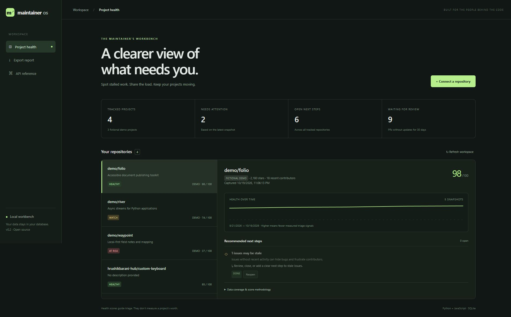

# MaintainerOS

[](https://github.com/hrushikbarani-hub/maintaineros/actions/workflows/test.yml)

MaintainerOS is a local tool that helps you decide what to work on in a GitHub repository. It saves dated snapshots, explains its findings, and lets you track tasks without changing anything on GitHub.



## Features

- Check public repositories for stale issues and pull requests, release gaps, and contribution concentration.
- Save and compare repository snapshots.
- Mark suggested work as handled or dismissed.
- Export reports as CSV, JSON, or Markdown.
- Try the app with fictional demo projects.

Scores are estimates based on a limited sample. They are not a final judgment about a project's health.

The app uses Python, FastAPI, and SQLite. Its interface uses plain JavaScript. Data stays in a local database.

## Run it

Requires Python 3.11 or newer. From the project folder:

```sh
python -m venv .venv
# Windows: .venv\\Scripts\\activate
# macOS/Linux: source .venv/bin/activate
python -m pip install -e ".[dev]"
python -m uvicorn maintaineros.main:app --host 127.0.0.1 --port 8001
```

Open [http://localhost:8001](http://localhost:8001). API docs are at `/docs`.

You can also run `./run.ps1` on Windows or start the app with Docker:

```sh
docker compose up --build
```

## CLI examples

```sh
python -m maintaineros.cli scan owner/repository
python -m maintaineros.cli report --format markdown
python -m maintaineros.cli policy owner/repository
```

Use `--db path/to/file.sqlite3` to select a different database.

## Settings and safety

Copy `.env.example` to `.env` when using Docker Compose. Settings include the database path, demo data, an optional GitHub token for higher API limits, and an optional write token.

Keep the server on your own computer unless you add HTTPS, access control, and a write token. This app has one shared workspace and does not create separate user accounts.

## Development

```sh
python -m pytest -q
python -m ruff check .
python -m ruff format --check .
python -m build
```

See [contributing](CONTRIBUTING.md), [architecture](docs/architecture.md), and [roadmap](docs/roadmap.md). This project uses the MIT license.
