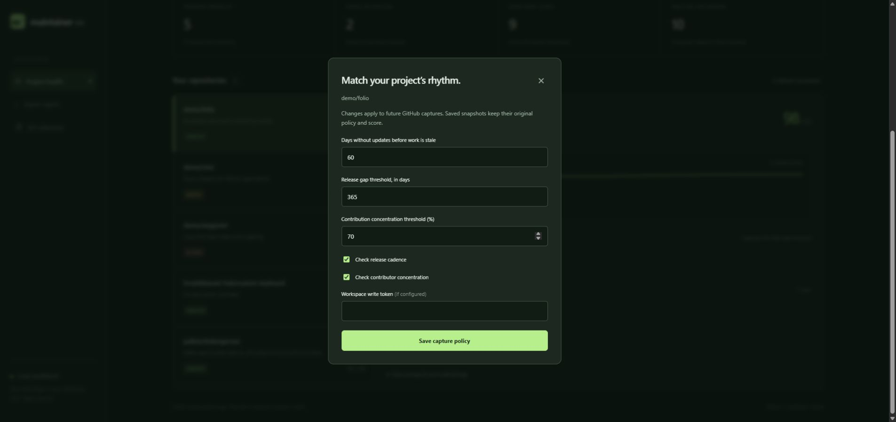

# MaintainerOS

[](https://github.com/hrushikbarani-hub/maintaineros/actions/workflows/test.yml)

**A clearer view of what needs you.** A local maintainer workbench that turns GitHub activity into an explainable action queue, with dated snapshots and a history you own.

Maintainers usually know how many issues exist. The harder question is what to do next. MaintainerOS gathers a bounded slice of repository activity, makes its limitations visible, and lets you track the resulting work without changing anything on GitHub.


## What works today

- Import a **public GitHub repository** from the browser or CLI. No account or API key is required for modest use.
- Identify stale issues/PRs, concentrated contribution activity, and long release gaps. Configure thresholds per repository; disable release or concentration checks when inappropriate.
- Inspect the oldest sampled stale issues and PRs directly from each recommendation, with GitHub links and their age at capture.
- Compare two saved captures: scores, activity metrics, and newly/no-longer observed items, with warnings about changed policy or data coverage.
- Mark recommendations handled or dismissed, and reopen recurring work. States survive restarts.
- Export current reports as CSV, JSON, or Markdown.
- Start with three explicitly fictional demo projects, or disable demo data for a fresh workspace.

The backend is Python/FastAPI, the UI is plain JavaScript, and SQLite stores data locally. No frontend build, analytics service, external fonts, or model API is required.

## Quick start

Requires Python 3.11+. From the repository folder:

```sh
python -m venv .venv
# Windows: .venv\Scripts\activate
# macOS/Linux: source .venv/bin/activate
python -m pip install -e ".[dev]"
python -m uvicorn maintaineros.main:app --host 127.0.0.1 --port 8001
```

Open [localhost:8001](http://localhost:8001). Interactive API documentation is at `/docs`.

On Windows, `./run.ps1` creates the environment, installs dependencies, and starts the server. If Python is not on PATH, use `./run.ps1 -Python 'C:\path\to\python.exe'`. To only install, add `-SetupOnly`.

Or use Docker:

```sh
docker compose up --build
```

Compose exposes port 8001 on the local computer and persists the database in a named volume. Docker builds are checked in CI.

## Try the workflow

1. Choose a demo repository to inspect its score history and recommended actions.
2. Select **Connect a repository** and enter `owner/repository`.
3. Inspect the report's **Data coverage & score methodology** section.
4. Mark one recommendation handled. Reload to see the saved state.
5. Import the same repository later to add another snapshot.
6. Open **Compare saved captures** to inspect changes, or **Configure capture policy** to adjust future imports without rewriting history.

The refresh button reloads stored data. Capturing current GitHub activity requires another import. Handled states persist across snapshots and do not modify scores or GitHub issues.

Item-level evidence is saved by new GitHub imports. Older snapshots remain readable; re-import a repository to capture issue/PR details. Findings show up to five oldest matching items from the bounded sample.



## CLI

```sh
python -m maintaineros.cli scan owner/repository
python -m maintaineros.cli scan owner/repository --fail-under 60
python -m maintaineros.cli report --format markdown
python -m maintaineros.cli report --format json
python -m maintaineros.cli policy owner/repository
python -m maintaineros.cli policy owner/repository --stale-days 60 --release-gap-days 365
python -m maintaineros.cli policy owner/repository --no-check-releases --concentration-threshold 0.85
```

An installed `maintaineros` command provides the same interface. `--db path/to/file.sqlite3` selects another database. Exit codes: 0 success, 1 score below the requested threshold, 2 validation/network failure. Scores are heuristics; assess repository context before using a threshold as a gate.

The `policy` command can configure a repository before its first capture. Stale thresholds accept 1–365 days; release thresholds 1–3650 days; concentration thresholds 0.5–1.0. Omitted options retain their current values. Browser policy settings apply to an already imported repository.

## Configuration

| Variable | Default | Purpose |
| --- | --- | --- |
| `MAINTAINEROS_DB` | `data/maintaineros.sqlite3` | SQLite file path |
| `DEMO_DATA` | `1` | Seed fictional projects only when the database is empty |
| `WRITE_TOKEN` | empty | Require `X-Write-Token` on imports, policy changes and action updates |
| `GITHUB_TOKEN` | empty | Optional server-side GitHub token to raise request limits |

Copy `.env.example` to `.env` for Docker Compose, or pass `--env-file .env` to Uvicorn. Direct Python runs do not automatically load `.env`. Disabling demo seeding does not remove existing demo records; use a new database for a fresh workspace.

Keep the default loopback binding for personal use. Before exposing the service, configure `WRITE_TOKEN`, HTTPS and access control at a reverse proxy, plus request/body limits. This release has one shared workspace, not per-user accounts. Read endpoints expose workspace data to anyone who can reach the server.

## How the score works

Start at 100. Subtract 2 per stale issue (maximum 25), 4 per stale PR (maximum 25), 15 for high contributor concentration, and 10 for a long release gap. Default policy: stale after 30 days, concentration at least 70%, release older than 180 days. Scores ≥80 are `healthy`, 60–79 are `watch`, and below 60 are `at_risk`.

Each snapshot stores its own policy. Updating settings affects future GitHub captures only; it never changes historical scores. Legacy snapshots use the original default policy. Manual snapshots must provide counts consistent with their declared policy; the app does not recalculate supplied counts from partial item evidence. Comparing different policies is explicitly labeled as not like-for-like. An issue absent from a later bounded sample is **not necessarily closed**.

Imports inspect up to 500 open issues/PRs and 500 commits from the last 90 days. Unlinked authors and GitHub bot accounts are excluded from concentration metrics. A repository at the cap is explicitly labeled as sampled; older stale work may be understated. Unknown release and contributor data are not penalized. A high score with limited observations is not proof of a healthy project.

GitHub's issues API includes PRs; the importer separates records using the `pull_request` field. See the [GitHub issues API](https://docs.github.com/en/rest/issues/issues#list-repository-issues) and [commits API](https://docs.github.com/en/rest/commits/commits#list-commits).

## Development

```sh
python -m pytest -q
python -m ruff check .
python -m ruff format --check .
python -m build
```

Install `.[dev]` for tests, formatting, and build tools. See [architecture](docs/architecture.md), [contributing](CONTRIBUTING.md), and [roadmap](docs/roadmap.md). MIT licensed.
